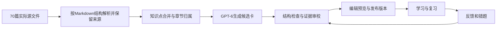
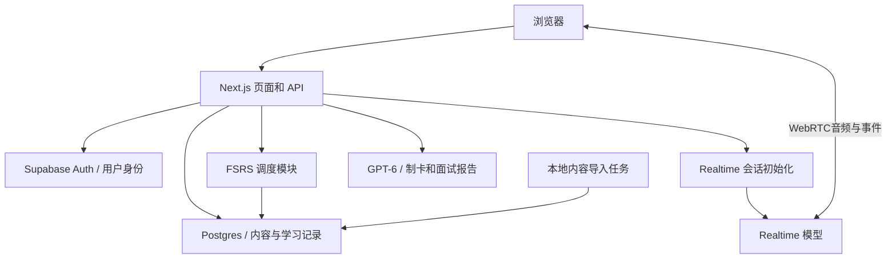

# AI PM 记忆网站：产品与体验设计

版本：v0.1，待评审设计稿 · 2026-09-05

项目：当前仓库
知识源：由本机环境变量 `KB_SOURCE_PATH` 指定，不进入仓库
已确认投入：工作日每天 30 分钟，周末另做模拟面试。

## 1. 产品要解决什么问题

让 AI PM 知识从“看过”变成“能独立回忆、能做产品判断、能在面试中讲清楚”。

推荐建设一套**有课程路径的间隔复习网站**：原知识库提供章节和证据，记忆卡提供主动回忆，FSRS 安排复习，周末面试检验迁移与表达，再把薄弱点带回下一周。

首轮成功标准：

- 用户进入首页后，能在一次点击内开始今天的任务，知道预计耗时。
- 每张正式卡有明确问题、最小正确答案、评分依据与可定位来源。
- 工作日任务围绕 30 分钟调整；积压时减少新卡，明确显示剩余工作量。
- 评分记录持久保存，多设备不会重复计次或覆盖彼此的进度。
- 周末面试问题来自本周实际学过的内容；复盘指出具体遗漏与下一步练习。
- 用户可区分“记忆表现”和“面试表现”，不会被一个模糊的掌握度百分比误导。

本轮交付是设计文档与样卡。网站、数据库迁移、批量制卡、云部署均在设计评审之后实施。

配套文档：

- [课程规划与卡片样例](./2026-09-05-curriculum-and-cards.md)：9 章配置、技术攻克 26 节、16 周路线、首周安排、14 张样卡与 2 道面试题。
- [数据库、接口与脚本设计](./2026-09-05-data-and-api-design.md)：Supabase 表、RLS、复习事务、接口、迁移顺序、环境变量与验收。

## 2. 已核对的项目和知识库现状

### 2.1 文件盘点

实际章节内共有 **70 篇 Markdown，1,098,514 个字符**。字符统计包含 Markdown 标记，不等于汉字数或模型 Token 数。

| 原章节 | Markdown 篇数 | 字符数 | 在产品中的用途 |
| --- | ---: | ---: | --- |
| 第1章 入门Ai产品经理 | 7 | 43,315 | 基础筛查、岗位认知、沟通基本功 |
| 第2章 深度了解AI PM | 4 | 61,686 | 能力地图、职责与交付物 |
| 第3章 技术攻克 | 26 | 533,569 | 核心记忆牌组，分为 7 条能力路径 |
| 第4章 VibeCoding | 3 | 22,445 | 验证与原型实践 |
| 第5章 AI产品设计 | 7 | 114,370 | 需求、成本、PRD、边界与验收 |
| 第6章 行业案例 | 5 | 92,908 | 场景应用、面试案例 |
| 第7章 商业必谈 | 3 | 55,972 | 单位经济、商业模式、价值判断 |
| 第8章 产品密谈 | 14 | 45,371 | 有日期的讨论素材，区别于长期事实卡 |
| 第9章 产品思维 | 1 | 128,878 | 440 个问题，提炼思维方法与开放讨论 |
| **合计** | **70** | **1,098,514** | |

核对范围：完成全量文件盘点、清单与哈希比对，重点阅读 RAG、Function Call、MCP、Evals、Token 成本及跨章节样本；不是对 70 篇材料逐句完成事实审校。

### 2.2 会直接影响实现的发现

1. `manifest.json` 只有 66 条；66 个已登记文件的当前 SHA-256 均与清单一致。遗漏的 4 篇为 `3.25-Evals.md`、`3.26-FDE-Ontology.md`、`Grok-Bot-橙皮书.md`、`产品思维培养.md`。导入以实际章节文件为准，清单用于补充原始来源。
2. `3.10 向量数据库与嵌入模型`、`3.16 Embedding`、`3.20 VectorDB` 存在概念交叉；`3.23 技术指标` 和 `3.25 Evals` 也需要统一知识点标识。否则用户会反复背同一个定义。
3. 文档混合长期知识、类比、观点、时事与示例数字。例如 RAG 文中有未就地提供出处的“超过 80%”描述；产品思维文中也有基于具体商业现象的解释。制卡不能把所有句子等同于已验证事实。
4. Markdown 正文中有远程图片，目录同时有本地 assets 和资产清单；另有 HTML 资产。图片应先核对映射，本地 HTML 不能作为受信任脚本直接嵌入产品。
5. 第9章明确写有原创与禁止抄袭提示。个人知识库默认私有；分享网站时，公开示例牌组与这份源材料分开配置，分享内容需有清楚的授权范围。
6. 当前项目为空，尚无 Git 仓库、代码或依赖；项目与知识库目录内均未找到 `.env`。未连接 Supabase，也未检验账号模型权限。

## 3. 产品方案取舍

| 方案 | 优点 | 代价 | 判断 |
| --- | --- | --- | --- |
| **课程路径 + FSRS + 周末面试** | 能将知识结构、记忆与表达连起来 | 需要内容审校和两类评估 | **推荐**，最贴合本次目标 |
| 通用 Anki 式牌组工具 | 复习功能集中，上手快 | 用户自己安排章节与面试，容易碎片化 | 可作为更小的工具，覆盖目标不足 |
| 自由对话式 AI 导师 | 灵活、解释自然 | 进度难衡量、持续调用成本高、复习不稳定 | 作为卡片解释入口，暂不作为主界面 |

产品暂用项目名 **AI PM / Recall Studio**，仅作为设计工作名，不锁定最终品牌。

## 4. 学习系统：按章节组织，按依赖和熟悉程度推进

### 4.1 三层结构

`大章节（Deck） → 学习单元（Lesson） → 知识点（Concept） → 卡片（Card）`

每张卡有唯一主归属章节，可关联多个来源和知识点。跨章节引用同一张卡，不复制一份新的复习状态。

“技术攻克”在导航中是一个完整大章，在课程中拆成模型基础、上下文、RAG、Agent、互操作、评估、业务建模 7 条路径。**章节是地图，学习计划是路线。**

### 4.2 首次使用

1. 选择目标：系统建立基础／已有 PM 经验转 AI／面试强化。
2. 确认每天 30 分钟、时区 Asia/Shanghai、周末面试偏好。周末默认建议周六，可随时启动或调整。
3. 对能力模块自评：未接触／了解概念／做过项目。
4. 可选做 8–12 道闭卷诊断题，涵盖角色、RAG、工具调用、Evals、产品取舍。
5. 生成建议路径，解释“为什么从这里开始”；用户可改为原章节顺序。

首次诊断占当天预算，不额外塞入完整学习任务。自评只影响顺序与建议，不凭自评捏造 FSRS 稳定度或学习历史。答过的诊断题若符合正式卡的闭卷、揭示答案、本人评分流程，可以计为真实首次复习；开放讨论题单独记录。

熟悉模块可暂时跳过，但显示“自评熟悉／尚未验证”。之后穿插少量诊断；发现薄弱后推荐补前置课，不重置其他学习进度。

### 4.3 每日 30 分钟预算

| 环节 | 默认预算 | 行为 |
| --- | ---: | --- |
| 到期复习 | 12 分钟 | 优先处理当天到期及遗忘风险高的积压 |
| 一段微课 | 5 分钟 | 阅读一个学习单元摘要及必要例子 |
| 新卡 | 8 分钟 | 冷启动每天 4 张，逐步到 4–6 张 |
| 口头迁移 | 3 分钟 | 用一个场景解释今天的概念，可先自行口述 |
| 收尾与缓冲 | 2 分钟 | 一条收获、下一步、同步状态 |

这是初始预算，不是能保证完成的卡数。新卡按约 80–120 秒、熟卡按约 20–40 秒估算；七天后用用户真实耗时中位数调整。新卡同日重学也占预算，不能漏算。

调度规则：

- 每次开始时刷新到期队列；学习过程中穿插已到期的同日重学卡。
- 预计复习超过 20 分钟：新卡降为 0，把剩余时间用于修补概念。
- 有余量才加入新卡；新卡受前置知识、当天时间、章节目标共同约束。
- 达到 30 分钟时出现“今天先到这里／继续 5 分钟”，不强制中断正在作答。
- 未完成卡保留真实到期时间，首页诚实显示积压；不通过偷偷修改 due 消除欠账。
- 周末默认无新卡，建议 5–10 分钟处理到期卡；面试另外安排 25–35 分钟。
- 中断多日后进入恢复模式，先压低新卡，逐步清理积压；保留历史，不惩罚断签。

初始核心卡预算 **360 张**，课程按 **16 周主题路线**组织。若每周五天平均 4.5 张新卡，16 周可首次接触 360 张；这不代表已经长期掌握。实际周期随复习负荷延长，不承诺固定日期通关。

## 5. 复习算法：FSRS，工程基线使用已核对的 FSRS-6 实现

### 5.1 为什么选它

艾宾浩斯曲线描述遗忘现象，不能直接替代个体调度器。本产品需要根据真实回忆结果更新每张卡的下一次复习时间。

FSRS 已用于 Anki，具备明确的记忆状态与目标保留率，适合直接集成；默认目标保留率设为 0.90。它是调度目标，不是“你有 90% 的面试通过率”。[Anki FSRS 文档](https://docs.ankiweb.net/deck-options.html#fsrs)

| 候选 | 适合之处 | 本项目取舍 |
| --- | --- | --- |
| 固定 1、3、7、14 天 | 容易解释 | 无法体现不同卡片与不同人的差异 |
| 经典固定公式调度 | 简单，传统工具兼容性好 | 本项目无遗留包袱，优先选择 FSRS |
| FSRS | 有成熟库、可记录状态、可用历史校准 | **选用** |
| 研究型神经调度模型 | 在部分预测基准上有优势 | 训练、部署与可解释成本超出当前需求 |

本次官方仓库核对发现：基准已包含 FSRS-7 和其他分数更高的研究模型；`ts-fsrs` 主分支包声明为 5.4.2，其参数校验仍明确支持到 FSRS-6 的 21 参数。**包版本不等于算法版本，不能把“基准已出现”当成“生产库已支持”。**设计基线选择 FSRS-6，实施时再次核对稳定发行包并锁定 lockfile。[参数实现](https://github.com/open-spaced-repetition/ts-fsrs/blob/main/packages/fsrs/src/default.ts) · [包声明](https://github.com/open-spaced-repetition/ts-fsrs/blob/main/packages/fsrs/package.json)

不宣称它是所有维度的全球第一。官方基准评估的是回忆预测，在不同数据切分和同日复习口径下成绩不同，不能直接推导本人的学习效率提升百分比。[SRS Benchmark](https://github.com/open-spaced-repetition/srs-benchmark)

### 5.2 评分文案与操作

| 键位 | 主文案 | 辅助判断 | FSRS Rating |
| --- | --- | --- | --- |
| 1 | 完全记不清 | 答错、漏核心点，或看了提示才想起 | Again = 1 |
| 2 | 模糊记得 | 很费力，但在看答案前独立答对核心点 | Hard = 2 |
| 3 | 记得 | 独立答对，回忆顺畅 | Good = 3 |
| 4 | 很熟练 | 很快且完整地独立答对 | Easy = 4 |

“眼熟”不等于成功回忆。Hard 的含义是费力的成功回忆；遗忘却打 Hard 会使调度偏离真实表现。[Anki 评分说明](https://docs.ankiweb.net/deck-options.html#fsrs)

揭示答案后才出现四档。每档下方显示当次算法算出的预计间隔，不硬编码“明天／3天／7天”。预览与提交使用同一份调度参数、基准时间和随机种子；过期或版本冲突时刷新预览。

不设置“能举例才算 Easy”：举例迁移由独立场景题评估，避免将两个不同任务混成一个记忆评分。AI 可以解释答案覆盖情况，但不代替用户点击记忆档位。

### 5.3 状态、参数与特殊情况

- 算法状态：New、Learning、Review、Relearning。暂停、埋藏、内容下架是独立的可用性字段。
- 使用库返回的完整状态；稳定度、难度、due、last_review、reps、lapses 和学习步数等一起持久化。
- 初始使用库默认权重；短期学习步骤建议 1m、10m，重学 10m，通过实际库用例验证，不另写一套倍率规则。
- 目标保留率调整后默认作用于后续复习；若要全量重排，先呈现预计工作量变化。
- 初期不训练个人权重；积累足够跨日样本后再做离线拟合和时间留出验证。优化器是独立能力，不能把普通 `ts-fsrs` 调度调用说成自动训练。[ts-fsrs 与优化器](https://github.com/open-spaced-repetition/ts-fsrs)
- 同一知识点的兄弟卡默认错开到另一天；这是队列资格变化，不伪造复习记录。
- 连续多次失败的卡提示“拆卡／补微课／暂停”，不只是越来越频繁地轰炸。
- 提示阅读、自由浏览、AI 解释、面试追问均记录为练习或暴露事件，不默认为正式回忆成功。
- 初版正式复习需在线提交；断网可保留当前未确认操作，恢复后重试。暂不承诺整套离线复习与多设备离线合并。

## 6. 卡片设计与内容生产

### 6.1 什么适合变成卡

优先制成“一个清晰判断”的卡：概念边界、因果解释、技术选择、指标计算、异常定位。长列表拆小；复杂案例进入面试题，不强行要求几十秒内复述整篇文档。

核心牌组拟采用：概念卡约 35%、对比与误区约 25%、场景判断约 25%、计算与诊断约 15%。比例是编辑预算，可根据实卡审校调整。

每张卡的背面层级：

1. 一句话核心答案。
2. 1–3 个必答点，用于本人判断是否答对。
3. 一个常见误区。
4. 可折叠的解释与例子。
5. 来源章节、原段落、内容版本及有效日期。

禁止用“请完整介绍 RAG”“背诵 Transformer 所有步骤”这样的题冒充原子卡。选择题可用于首次诊断，日常复习优先主动回忆，避免答案选项成为提示。

### 6.2 导入与制卡流水线



- 解析器识别代码围栏、表格和标题层级；不能把围栏内的 `## 参考资料` 当成真实章节。
- 以学习目标和语义段落分块，过长段落再拆；不把 100 多万字符一次交给模型批量自由发挥。
- 使用稳定概念 ID 做近似重复合并，保留多来源；改写问题不能天然算作新知识点。
- 每个生成批次记录源文件哈希、段落哈希、模型 ID、提示版本、审核状态、耗用量。
- 原文不支持的补充必须标“教学延伸”并补来源；来源冲突、无出处统计、时效内容进入待核验队列。
- 第8章按日期、论点、证据与反论点组织讨论；不默认进入长期背诵队列。
- 第9章的 440 题先去重、抽象方法，避免生成 440 张固定标准答案卡；开放判断允许不同结论，只要论证成立。
- 卡片说明用重新组织的简短语言；源全文、个人补充、公开示例分别管理。

首个内容试点建议用 RAG、Function Call、MCP、Evals 四个主题，先审 30–40 张，再扩展 360 张核心牌组。样卡是设计样稿，不代表已完成全量题库。

### 6.3 内容验收门槛

每张正式卡都要有有效来源、唯一核心问题、明确评分点；技术词义与结论不能超出证据。全部候选经结构检查，关键定义、计算题、来源冲突及所有公开卡逐张审校。其余按主题批次抽查，发现系统性问题即整批退回。

语义有实质变化的修订生成新版本，并提示重新学习；仅排版修订保留调度。历史评分固定关联当时看到的卡片版本，不用新答案覆盖旧证据。

## 7. 周末语音模拟面试

### 7.1 训练组成

建议周六进行 25–35 分钟训练，周日可做 10 分钟针对性重答。预约只是网站内计划，不自动发起电话；到时进入首页即可开始，提醒后续可选。

| 阶段 | 预算 | 内容 |
| --- | ---: | --- |
| 热身 | 3 分钟 | 用自己的话解释一个本周概念 |
| 场景主问题 | 10 分钟 | 围绕本周技术或产品判断进行追问 |
| 约束变化 | 7 分钟 | 添加成本、权限、时延或效果限制 |
| 简短反馈 | 5 分钟 | 指出最关键的问题，练一次重答 |
| 查看报告 | 5 分钟 | 核对证据、选择下周补练项目 |

实际出题采用约 60% 本周新学、30% 本周薄弱、10% 历史已学知识的目标比例。一个题可以覆盖多个概念；按概念覆盖计比例，不机械要求整数题数。没有历史内容时重新分配；本周没学习时建议恢复训练或历史复盘，不编造本周主题。

“本周”按用户时区的周一开始，截至创建面试题包的时间。保存窗口、卡片版本和内容快照；面试中即使更新牌组，本场评分依据也不漂移。

### 7.2 模型分工

| 工作 | 默认模型设计 | 调用时机 |
| --- | --- | --- |
| 候选制卡、难题检查 | `gpt-6-astra` | 内容导入批处理 |
| 面试题包与评分量表 | `gpt-6-astra` | 用户准备面试时 |
| 实时语音、打断与追问 | `gpt-realtime-2.1` | 用户主动开启语音后 |
| 逐字稿证据核对与复盘 | `gpt-6-astra` | 面试结束后 |
| 日常卡片展示与 FSRS | 无需模型 | 直接读内容与运行调度器 |

官方 GPT-6 Astra 模型页列出文本/图像输入与文本输出；实时语音因此使用独立的 Realtime 模型。以上是当前文档支持的候选 ID，用户账号实际可用性与调用费用需在实施时验证，不能从当前 Codex 对话推定。[GPT-6 Astra](https://developers.openai.com/api/docs/models/gpt-6-astra) · [GPT-Realtime-2.1](https://developers.openai.com/api/docs/models/gpt-realtime-2.1)

通过服务端环境变量配置模型，账号不支持时呈现明确原因，不静默切换后仍显示 GPT-6。模型性能、UI 美感和学习结果分别验收，不把使用某个模型当作质量保证。

### 7.3 语音连接与失败处理

浏览器通过 WebRTC 直接连接 Realtime；Next.js 服务端验证用户与配额后创建会话，采用官方 unified SDP 接口。长期 OpenAI Key 只存在服务端。初版不需要让 Vercel 函数转发整场音频。[OpenAI WebRTC 文档](https://developers.openai.com/api/docs/guides/realtime-webrtc)

交互状态：准备 → 请求麦克风 → 连接中 → 面试官说话 ↔ 我在回答 → 暂停／结束 → 生成复盘 → 完成。

- 提供静音、暂停、结束、打断、字幕和按住说话；噪声环境可切为手动回合。
- 无麦克风权限：解释如何重新授权，同时可以转为文字面试。
- 连接超时或供应商不可用：保留题包，允许重连或文字回答，不显示虚假的在线波形。
- 断线按新会话续接已确认文本摘要；不承诺补回丢失音频。
- 结束时关闭麦克风轨道和连接；逐字稿不完整时标“报告依据不完整”。
- 默认保存经用户知悉的逐字稿与报告，不保存原始音频；将来录音需单独开关与删除能力。
- 初版一场最多 30 分钟语音，最长总训练时间允许由报告阅读构成；页面预告剩余时长。公开版的强制成本封顶需要可信服务端会话终止与用量核对，不能只靠浏览器倒计时。

### 7.4 面试评分和复习评分分离

报告使用五维量表，每维 0–4 分：概念准确、场景判断、取舍依据、风险与评估、表达结构。无足够证据时为 N/A，不强行给分。完整场次可按 30%／25%／20%／15%／10% 汇总，但必须展示维度与原话证据。

每个问题返回：答对的点、遗漏或错误、逐字稿引用、合理回答框架、一个下一步练习。不同合理技术方案可得分；不按答案逐字匹配，也不把语速、口音当成能力评分。

面试只生成薄弱概念和补练建议。用户选择“加入补练”后形成练习任务；已有卡不复制，面试得分不直接修改 FSRS 状态或冒充 Good/Again。

## 8. 信息架构与页面

桌面左侧固定导航：**今日 / 课程 / 卡片库 / 面试 / 进度**。设置放在头像内。手机底部保留今日、课程、面试、我的；卡片库从课程或搜索进入。

| 页面 | 主要任务 | 首屏重点 |
| --- | --- | --- |
| 今日 `/today` | 开始或继续今天学习 | 一个主按钮、剩余时间、到期与新学数量 |
| 学习 `/study` | 闭卷回忆与评分 | 单张卡、揭示答案、四档评分 |
| 课程 `/curriculum` | 看学习路径与章节 | 当前节点、先修关系、推荐下一步 |
| 章节 `/chapters/[slug]` | 理解本章与选课 | 章节导语、单元列表、核心/扩展切换 |
| 卡片库 `/cards` | 搜索、筛选、查看出处 | 关键词、章节、卡型、暂停/薄弱筛选 |
| 面试 `/interview` | 准备训练、看历史报告 | 本周覆盖、练习目标、开始按钮 |
| 面试房间 `/interview/[id]` | 实时沟通 | 当前问题、字幕、语音状态、控制区 |
| 报告 `/interview/[id]/report` | 找出问题并重练 | 证据、五维评分、最多三条优先行动 |
| 进度 `/progress` | 判断是否在稳步进步 | 跨日回忆、本周投入、能力证据 |

内容编辑台属于维护端，首版通过导入与审校流程实现；不同时建设完整 CMS。

## 9. 视觉方向：未来研究室里的纸质卡片

### 9.1 候选方向

| 方向 | 特征 | 判断 |
| --- | --- | --- |
| **深色工作台 + 暖白纸卡** | 石墨底、酸橙点色、精确排版、卡片形成视觉焦点 | **推荐**，探索与专注均衡 |
| 极简白色学习书桌 | 温和、阅读负担低 | 可作为浅色主题，首眼辨识度较弱 |
| 沉浸式星图实验室 | 空间感、知识节点动画 | 用于课程页局部意象；全站使用会增加噪声和性能成本 |

主意象是一条贯穿章节的细“记忆轨道”：课程页节点体现进度；卡片详情用真实调度数据绘制回忆预测曲线。它不能只是一条随机波形，更不能被画成真实测量的大脑状态。

### 9.2 设计 Token 草案

| 用途 | 值 | 说明 |
| --- | --- | --- |
| 工作台背景 | `#10120F` | 微暖石墨色 |
| 二级面板 | `#1A1E18` | 与背景形成轻层次 |
| 记忆卡纸面 | `#F2F0E7` | 长时间阅读的主体 |
| 纸面主文字 | `#172018` | 清晰高对比 |
| 暗面主文字 | `#EEF1E7` | 导航与大标题 |
| 暗面辅助文字 | `#ACB5A6` | 标签、解释 |
| 品牌强调 | `#D2F46F` | 开始、当前节点、少量焦点 |
| 失败 / 费力 / 成功 / 轻松 | `#F0A39A` / `#EDC778` / `#B9D7AD` / `#A9C9E7` | 始终配文字和图标，不只靠颜色 |
| 圆角 | 面板 16px，纸卡 24px，按钮 12px | 避免全站胶囊化 |
| 间距 | 4 / 8 / 12 / 16 / 24 / 32 / 48 / 64px | 8px 基础节奏，局部 4px |

中文正文优先系统苹方与可靠中文无衬线回退；章节标题可少量使用思源宋体，英文展示可用 Manrope，计时与指标用等宽数字。只加载必要字重；字体授权与体积在实现时核对，加载失败仍保持布局。

大标题桌面 48–64px，手机 32–36px；卡片题目桌面 28–34px、手机 22–26px；正文至少 16px，长答案行高约 1.7。设计 Token 是方向稿，交付代码前验证所有实际文本组合的对比度。

### 9.3 今日页线框

```text
┌──────────┬──────────────────────────────────────────────────────────┐
│ AI PM    │ 周四 · 第 04 周                           搜索    头像   │
│ RECALL   │                                                          │
│          │ 把 RAG，讲成一个能落地的方案。                            │
│ ● 今日   │ 今天约 30 分钟 · 先复习，再学一个小主题                   │
│   课程   │                                                          │
│   卡片库 │ ┌──────────────────────────┐ ┌────────────────────────┐ │
│   面试   │ │ 继续今日学习             │ │ 本周主题 / RAG          │ │
│   进度   │ │ 到期 24 · 新学最多 4     │ │ 检索 → 生成 → 评估      │ │
│          │ │ 上次停在 混合检索        │ │ 周末：知识库产品面试    │ │
│          │ │ [ 开始  → ]              │ │ [ 查看准备内容 ]        │ │
│          │ └──────────────────────────┘ └────────────────────────┘ │
│          │ 你的课程轨道   基础 ── 上下文 ── ●RAG ── Agent ── …    │
│          │ 需要补强       Recall@K 的分母 · RAG 与微调的边界        │
└──────────┴──────────────────────────────────────────────────────────┘
```

线框中的数量是示例数据。真实数据未加载时显示骨架和明确占位，不把示例数混进用户统计。

### 9.4 学习页线框与状态

```text
  ← 今日           技术攻克 / RAG                  本次 08 / 24

         ┌────────────────────────────────────────────────┐
         │  场景判断                              预计 45秒 │
         │                                                │
         │  企业知识库每天更新，                         │
         │  为什么通常先考虑 RAG？                       │
         │                                                │
         │  先在心里回答，或输入你的判断……               │
         │                                                │
         │              [ 显示答案  Space ]               │
         └────────────────────────────────────────────────┘

  揭示后：一句核心答案 → 必答点 → 展开解释 → 来源
  [1 完全记不清] [2 模糊记得] [3 记得] [4 很熟练]
    算法预计间隔   算法预计间隔   算法预计间隔  算法预计间隔
```

- 答题时收起主导航，以 720–800px 宽单卡为中心；显示答案后以垂直展开替代炫目的 3D 翻转。
- 源文与解释默认折叠，防止未作答就被剧透。AI 解释打开前提示它属于学习帮助。
- 评分提交期间锁定重复操作；服务器确认后显示下一张。失败时保留答案与选择，提供重试。
- 手机四档采用 2×2 大按钮，底部安全区适配；按钮区为正文预留空间，不遮挡长答案。
- 键盘 Space 揭示，1–4 评分；输入框聚焦时这些键正常输入；来源抽屉可 Esc 关闭。
- 撤销最近一次评分须同步回滚状态，不能只改页面计数；其他设备已继续复习时返回冲突提示。
- 完成后展示“本次完成”，如仍有到期卡则另列剩余数量，不显示“全部清空”。

### 9.5 面试页与进度页

面试房间延续深色背景，以“正在听／正在思考／面试官说话”的小型信号环表示真实状态；左侧当前问题，右侧可折叠字幕，底部固定控制。正式训练不展示参考答案和评分量表全文；报告页再展示。

进度页以三组证据为主：

- 记忆：近 30 天跨日到期复习的成功率、样本量、到期积压和预测负荷。
- 覆盖：核心卡已接触数量／核心卡总量，各章的学习与复习状态。
- 迁移：面试五维表现、证据数量、最近一次练习日期。

不把三者揉成“你已经掌握 AI PM 87%”。样本不足时明确写“积累中”；FSRS 预测回忆率标为估计值。曲线在详情页解释，首页优先让用户开始学习。

### 9.6 动效、响应式与可访问性

导航与按钮反馈 120–180ms；卡片答案展开约 180–240ms。仅用 opacity/transform 做主体动效，支持 reduced-motion，语音页无常驻高负载 WebGL。

验收视口至少覆盖 390px、768px、1440px，额外检查 320px 与 200% 缩放；无整页水平滚动，评分触点至少 44px，键盘焦点可见，文本对比度按 WCAG AA 验证。公式、代码、长中文题目、错误态都使用真实材料做视觉检查。

## 10. 技术架构与部署

### 10.1 推荐技术栈

| 层 | 选择 | 原因 |
| --- | --- | --- |
| Web | Next.js App Router + React + TypeScript | 页面、鉴权和服务端 API 放在同一工程 |
| UI | Tailwind CSS + CSS variables + 按需无障碍组件 | 实现自定义视觉，避免套默认后台模板 |
| 数据 | Supabase Postgres + Auth + Storage | 卡片关系、个人进度、资源与权限统一管理 |
| 调度 | `ts-fsrs` | 调度纯逻辑可独立测试和替换 |
| 内容 | Markdown AST 解析 + 结构化校验 | 保留标题、表格、代码与引用 |
| 模型 | OpenAI 官方 SDK／Realtime WebRTC | GPT-6 文本任务与实时语音分工 |
| 验证 | Vitest、数据库权限测试、浏览器 E2E | 覆盖调度、原子提交和真实学习流程 |
| 部署 | Vercel + 独立 Supabase 项目 | 适合分享，预览与生产数据隔离 |

实施时选择当前相互兼容的稳定版并锁定版本；本轮没有安装依赖，不虚构“已验证最新组合”。Next.js 官方安装文档给出当前环境要求，开工时据此核对 Vercel 支持的 Node 运行时。[Next.js 安装文档](https://nextjs.org/docs/app/getting-started/installation)

### 10.2 请求路径



核心页面不用等待模型生成才能学习。内容制卡通过本地受控批任务完成；不在一次用户请求里处理整库。报告用可重试的持久任务状态，异步完成；不依赖 HTTP 返回后仍继续运行的进程。

第一阶段按预选题包传入精确材料，不需要向量数据库搜索全库。需要跨库问答时再引入 pgvector，避免因为课程有 VectorDB 章节就先为网站建立向量架构。

### 10.3 分享与成本

个人版先做账号持久化与私有课程；邀请他人时，每人的复习状态、笔记、面试独立。公开演示可用本项目新写的示例内容；启用共享课程时再设置课程级访问权限。

主要模型成本来自批量制卡与每周语音。普通刷卡没有逐卡模型费用。记录文本、缓存、音频等供应商实际 usage 与当时价格版本；在实测一次 10 分钟面试后再估算月成本，本轮不承诺免费套餐足够或虚构每分钟价格。

初版限制单用户并发一场、语音时长、报告重试次数和每日模型请求；公开注册前完善可信的服务端配额与超额终止。Vercel 的任务时长、套餐和运行时限制会变，部署时核对实际项目配置。[Vercel Functions 限制](https://vercel.com/docs/functions/limitations)

## 11. 分阶段交付与验收

| 阶段 | 范围 | 通过标准 |
| --- | --- | --- |
| D0 设计评审 | 本文、课程样卡、数据设计 | 确定学习预算、UI 方向、制卡深度与模型分工 |
| D1 内容试点与视觉样机 | 30–40 张审校卡；今日、学习、课程、面试房间的真实内容设计 | 四档语义明确，长答案和手机界面可用 |
| D2 完整记忆闭环 | Auth、Supabase、FSRS、课程计划、核心数据 | 评分持久化、重复提交与多设备冲突、退出恢复均通过 |
| D3 面试闭环 | 周题包、实时语音、报告、补练 | 真实打断与重连、证据报告、模型成本有实测 |
| D4 内容扩展与分享 | 核心 360 张按批发布，Vercel 部署，邀请使用 | 全量来源检查、账号隔离、配额与公开内容范围可验证 |

D2 是可日常使用的阶段，D3 才满足本次需求的完整学习目标；不把只有刷卡页面的样机叫作完整交付。

交付测试重点：调度使用固定时间和随机种子与库结果对比；模拟漏学、连续 Again、跨午夜、切时区；两用户与匿名 RLS；评分超时重试和双设备并发；语音权限拒绝、噪声打断、断线、报告失败；真实中文内容与移动端视觉检查。

## 12. 设计审查：最可能推翻方案的五个问题

| 风险 | 推翻信号 | 已纳入的修正 |
| --- | --- | --- |
| 30 分钟承载不了新卡与累积复习 | 连续一周超时、积压增长 | 时间预算优先，新卡可降到 0，周期顺延 |
| 源资料含未经核实的事实或重复概念 | 样卡审校出现同类错误 | 来源分级、统一概念、问题批次退回；暂缓时事事实卡 |
| “眼熟”被当成回忆成功 | Hard 高频而延迟测试失败 | 四档解释、闭卷后揭示、提示记录与独立诊断 |
| 语音服务不稳定或成本过高 | 真实网络中难以对话、试点费用超预算 | 独立文字路径、时长限制、文本模型复盘、实测后定额 |
| 漂亮仪表盘掩盖没有学会 | 刷卡数增长但面试没有改善 | 迁移证据单列、变式题、面试薄弱点回流 |

## 13. 评审时需要确定的选择

建议接受以下默认方案后进入实施：

1. 30 分钟／日，16 周主题路线，360 张核心卡预算，进度可以顺延。
2. FSRS-6 工程基线、四档评分、目标保留率 0.90。
3. 深色工作台与暖白记忆卡的视觉方向。
4. 先做好私有课程和账号，再开放可分享课程；所有人学习进度独立。
5. GPT-6 制卡与复盘、Realtime 语音面试；面试 API 可用性和预算在接入时验证。

数据库连接信息目前未在指定两目录找到；正式接入前需要可用配置文件路径或项目内环境变量。它不阻碍本轮方案评审。
