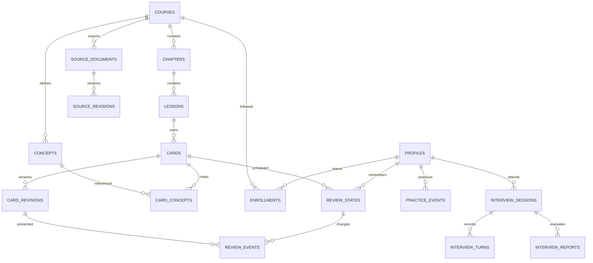

# Supabase、接口与脚本设计

版本：v0.1，逻辑设计与 SQL 契约草案 · 2026-09-05
配套：[整体设计](./2026-09-05-ai-pm-memory-design.md) · [课程与样卡](./2026-09-05-curriculum-and-cards.md)

本轮未连接数据库、未创建表、未执行迁移。当前项目和知识库目录内未发现 `.env`，以下环境变量名是建议契约，不是对现有配置的描述。

## 1. 数据设计原则

1. 内容与个人进度分离。同一课程的同一张卡可以被多人学习，各自独立调度。
2. 内容版本与历史证据不可被覆盖。源文和卡片修订后仍能解释旧复习事件。
3. 每次评分是一笔原子操作：事件追加和状态更新一起成功或一起失败。
4. 前端提交评分意图，服务端计算状态；用户不能直接提交任意 due 或稳定度。
5. 从私有课程起步。分享通过课程访问规则扩展，不公开个人日志和源文件路径。
6. 初版使用 SQL migrations + Supabase 客户端生成类型，不再增加另一套 ORM schema。

## 2. 实体关系



图中仅画主要外键关系。卡片修订的 `source_refs` 通过来源版本和段落标识引用源文，发布事务验证其合法性；后续如需要大量反向引用查询，可再拆独立关联表。

## 3. 内容表

通用约定：主键 UUID；时间使用 `timestamptz`；用户身份引用 `auth.users(id)`；面向人展示的序号和 slug 不作为唯一业务身份；每个子内容带 `course_id`，以组合外键保证跨层级属于同一课程。

| 表 | 核心字段 | 约束与用途 |
| --- | --- | --- |
| `courses` | id, owner_id, slug, title, visibility, content_version, created_at | visibility=private/public；默认 private。公开课程需要独立内容发布流程 |
| `chapters` | id, course_id, source_number, title, position | unique(course_id, source_number)，保持原9章 |
| `lessons` | id, course_id, chapter_id, slug, title, position, summary, prerequisite_ids | unique(chapter_id, slug)；前置关系在发布时校验无环和同课程 |
| `source_documents` | id, course_id, source_key, relative_path, original_url, source_kind | unique(course_id, source_key)；文件改名可更新路径，身份保持稳定 |
| `source_revisions` | id, course_id, document_id, content_sha256, body_markdown, blocks, imported_at, valid_as_of | unique(document_id, content_sha256)；正文不可变，blocks含标题路径、块ID、哈希和原始行号 |
| `concepts` | id, course_id, canonical_key, title, description | unique(course_id, canonical_key)；同一概念可由多个章节讲解 |
| `cards` | id, course_id, home_lesson_id, canonical_key, active_revision_id, lifecycle, created_at | unique(course_id, canonical_key)；lifecycle=active/retired；active_revision 必须属于本卡 |
| `card_revisions` | id, course_id, card_id, revision, kind, prompt, answer_short, required_points, explanation, pitfalls, source_refs, provenance_type, editorial_level, estimated_seconds, status, valid_as_of, recheck_after, published_at | unique(card_id, revision)；发布前内容校验；发布后不可变，修订插入新行 |
| `card_concepts` | course_id, card_id, concept_id, is_primary | primary key(card_id, concept_id)；每张卡至少一个概念，通过发布检查保证 |

`source_key` 优先沿用可信的原 page_id；四篇清单外文档分配持久 ID 并记录映射。首次导入建立映射文件，重跑复用；不把当前文件名作为不可变 ID。确有合并/拆分时显式登记 `supersedes`，不猜测后直接覆盖。

`source_refs` 的单项结构：

```json
{
  "source_revision_id": "<uuid>",
  "block_key": "<stable-block-id>",
  "heading_path": ["三、RAG 的检索策略", "混合检索"],
  "block_sha256": "<sha256>",
  "line_start": 209,
  "line_end": 227,
  "relation": "supports"
}
```

这里只示意结构，不是可直接导入的真实 UUID 记录。必须验证来源存在、属于本课程、哈希一致且支持答案；只有 JSON 格式正确不算证据审校通过。

源正文、真实本地路径与导入诊断放在不对浏览器直接开放的 schema 或通过专用 API 访问。公开卡只返回允许分享的内容和来源展示信息；课程公开不会自动公开原知识库全文。

## 4. 用户与学习表

| 表 | 核心字段 | 规则 |
| --- | --- | --- |
| `profiles` | user_id, display_name, timezone, day_start_hour, daily_minutes, preferences | user_id=auth.uid()；默认 Asia/Shanghai、04:00、30分钟 |
| `enrollments` | user_id, course_id, goal, route_mode, familiarity, plan_version, plan_json, scheduler_config, scheduler_config_version, paused_at | PK(user_id, course_id)；同一课程一份有效计划与调度配置 |
| `review_states` | user_id, card_id, course_id, fsrs_state, due, stability, difficulty, elapsed_days, scheduled_days, reps, lapses, learning_steps, last_review, scheduler_version, suspended_at, buried_until, row_version, last_event_id | PK(user_id, card_id)；标准库完整状态 + 可用性控制 + 并发版本 |
| `review_events` | id, user_id, card_id, card_revision_id, kind, rating, client_event_id, preview_at, received_at, client_occurred_at, duration_ms, state_before, state_after, scheduler_config_snapshot, scheduler_version, undone_event_id, session_id | append-only；正式 review 的 rating 为1–4；undo 引用被撤销事件 |
| `practice_events` | id, user_id, course_id, card_id?, concept_id?, interview_id?, kind, status, content, created_at | 诊断、提示暴露、面试补练等；不伪造 FSRS 正式评分 |

`plan_json` 保存路径顺序、当前主题、跳过原因、每日新卡上限、周末偏好和内容版本；每日到期队列实时计算，不为未来每一天存一份容易失效的大列表。

`scheduler_config` 保存实际库输出的配置、参数版本、目标保留率和短期步骤。数据库不把权重数量写死为 21；具体引擎验证对应版本合法性，为未来算法升级保留空间。

学习状态按用户第一次正式学习惰性创建，无需给每位新用户预先写入全库数百行空状态。队列里的新卡来自可学习卡减去已有状态。

重要约束：

- `unique(user_id, client_event_id)`：一次逻辑评分无论重试多少次只生效一次。
- review_events 的 `(user_id, card_id)` 外键指向对应 review_states；同一 card_revision 必须属于本卡。
- 所有 course_id 通过组合外键或事务校验保持一致，防止跨课程内容拼接。
- FSRS 数值必须有限、非负；未学习状态允许库定义的 0 值，不用过紧 check 拒绝合法初始状态。
- `row_version` 每次有效状态改变递增；暂停、恢复、埋藏等影响队列的操作也检查并发版本。
- 同一 review 事件最多被撤销一次；事件不物理删除，计算统计时排除被有效撤销的评分。
- 幂等键重用但载荷不同返回 409，不把不同请求错误地当同一次操作。

推荐索引：

| 查询 | 索引设计 |
| --- | --- |
| 用户到期卡 | review_states(user_id, due)，where suspended_at is null |
| 单课程到期卡 | review_states(user_id, course_id, due)；规模较小时先不重复建，以执行计划判断 |
| 每周学习记录 | review_events(user_id, received_at desc) |
| 单卡历史 | review_events(user_id, card_id, received_at desc) |
| 课程内容 | cards(course_id, home_lesson_id, lifecycle) |
| 卡片修订 | card_revisions(card_id, revision desc) |
| 源版本检查 | source_revisions(document_id, content_sha256) 唯一索引 |

## 5. 评分事务与多设备一致性

### 5.1 标准流程

```text
1. 用户打开题面；服务端检查课程访问权，返回卡片版本与当前状态版本。
2. 揭示答案时，服务端计算四档预览，返回签名 preview_token。
3. 用户选择档位；浏览器提交 rating + preview_token + client_event_id。
4. 服务端验证身份、卡片访问权、token签名、有效期、内容/配置/状态版本。
5. 使用与预览一致的时间和随机种子运行同版本 FSRS。
6. 调用仅服务端可执行的数据库提交函数。
7. 在同一事务中检查幂等键、锁定/比较版本、插入事件、更新状态。
8. 返回确认后的状态与下一题；浏览器才推进已完成计数。
```

`preview_token` 绑定 user_id、card_id、card_revision_id、row_version、scheduler_config_version、preview_at、随机种子及过期时间。签名不包含任何供应商密钥。初始有效期建议 10 分钟，超过后重新计算并显示新间隔，不丢弃用户答案。

为了保持展示与提交一致，调度基准使用揭示答案时的服务端 `preview_at`，实际入库时间为 `received_at`；两者都保存。跨日统计按实际确认时间及记录的时区上下文计算，复习间隔使用约定基准；差异受预览有效期约束。客户端时钟只作诊断，不作为权威调度时间。

不允许匿名或 authenticated 数据库角色直接调用“传入任意 state_after”的提交函数。此函数只授权服务端角色；它接收的 user_id 必须来自服务端已验证身份。服务端还要校验来源课程和内容版本，因为 service role 会绕过 RLS。

### 5.2 事务契约草案

下列是事务语义，省略完整 DDL、鉴权与错误处理，不能作为现成迁移执行：

```text
BEGIN
  查找 (user_id, client_event_id) 已处理请求
    若载荷一致：返回之前的完整确认结果
    若载荷不同：报冲突
  为新卡 INSERT 初始状态 ON CONFLICT DO NOTHING
  锁定 user_id + card_id 的状态行
  再查幂等键，处理等待锁期间已提交的重复请求
  比较 row_version、内容版本和调度配置版本
  插入 review_event，包含 before/after/config快照
  更新 review_state，row_version + 1，last_event_id = 新事件
COMMIT
```

内容发布和调度配置更新也必须与提交版本校验协调：提交函数在事务内读取并锁定/验证当前活动修订与配置版本，不能只在事务外校验一次。由此避免计算期间内容或权重被更新。

首卡并发：两个请求同时插入初始状态时，主键冲突合并为一行，再竞争行锁；一个成功后另一个得到陈旧版本错误。

响应约定：

- 200：首次成功或相同幂等请求重放。
- 401/403：未登录或无课程访问权。
- 409：状态/内容/配置变化，返回需要刷新的原因。
- 422：非法档位、签名不合法、过期预览或不可学习状态。
- 503：数据库或服务暂不可用；前端保留相同幂等键以安全重试。

多设备冲突不采用最后写入覆盖。另一设备已经复习时，显示“这张卡的进度已更新，正在同步”，并让用户继续新队列。旧操作不能再写出一个不同 due。

### 5.3 撤销、离线与内容修订

撤销最近一次评分：检查目标事件属于本人、仍是这张卡最新事件、尚未撤销、状态版本匹配；一笔事务恢复 before 快照、追加 undo 事件、递增版本。撤销需落库完成才改变界面。以后如要撤销更早历史，应重新回放日志，初版不提供。

初版只缓存当前待确认操作。断网后可看已经下载的题目，但暂停新的正式评分；恢复时先查询幂等结果再重试，不用本地临时 due 冒充云端同步成功。退出账号清理用户缓存。

内容实质修订：旧复习仍指向旧修订；用户看到“答案有更新”。展示更新属于学习暴露，不直接记为成功回忆。根据改动程度推荐重新学习；完全不同的问题应建新卡并关联替代关系，不能复用旧卡统计。

## 6. 时区、队列与熟悉度

- UTC 保存所有时间；用户时区和 day_start_hour 决定学习日。例如 Asia/Shanghai 04:00 开始新学习日。
- 计数使用时间区间 `[start, end)`，不直接对数据库 UTC 时间取 date。
- 周计划从本地周一开始，使用相同日界线计算；面试题包保存固定 week_start/week_end 和创建截止点。
- 时区变更不重写历史事件；新计划从后续学习日采用新时区，避免一天跨区重复领取新卡预算。
- 到期条件按当前瞬间 `due <= now()` 判断。今日预测与“现在可复习”分开展示。
- 新卡计数只统计首次进入正式学习的不同 card_id；同日重学算复习次数，不重复消耗新卡名额，但消耗时间预算。
- 熟悉度自评存在 enrollment；实际回忆记录存在 review_events。二者不互相覆盖。
- 预计耗时根据近期可用样本的中位数，按新卡/复习/场景题分别估计；样本不足时用设计初值。
- 兄弟卡按 concept 规则在当天队列中跳过，记录 buried_until；保留真实 due，不显示为已经复习。

## 7. 面试数据与报告任务

| 表 | 主要字段 | 规则 |
| --- | --- | --- |
| `interview_sessions` | id, user_id, course_id, week_start, week_end, cutoff_at, question_pack, rubric_version, provider_model, provider_call_id, status, started_at, ended_at, audio_consent, transcript_status, reserved_budget | 题包固定关联卡片修订与概念；同用户最多一个 preparing/connecting/active/closing 会话 |
| `interview_turns` | id, interview_id, user_id, provider_event_id, speaker, sequence, started_ms, ended_ms, text, is_final | unique(interview_id, provider_event_id)；去重，区分临时字幕和最终文本 |
| `interview_reports` | id, interview_id, user_id, revision, grader_model, prompt_version, transcript_hash, scores, evidence, gaps, recommendations, status | 报告版本保留，证据关联 turn_id；N/A 与0分区分 |
| `jobs` | id, user_id?, course_id?, kind, idempotency_key, status, input_refs, output_ref, attempts, next_attempt_at, lease_expires_at, error_code | 用于批次制卡和异步报告；成功结果可重复获取，失败可重试 |
| `usage_events` | id, user_id, interview_id?, job_id?, provider_request_id, model, input_units, output_units, unit_type, price_version, estimated_cost, billed_cost?, created_at | unique(provider_request_id, unit_type)；文本/音频/缓存分项，不从浏览器上报费用直接认账 |

题包范围：从实际 review_events 和 practice_events 取本周涉及的 card/concept；再次检查权限与内容状态，按比例选择。报告重跑使用同一题包和明确的逐字稿版本，避免材料变化导致评分不可比较。

浏览器文本事件可能缺失、重复、乱序，服务端按 provider_event_id 去重；最终报告只使用已确认文本，收到结束信号后等待短暂补齐窗口，标注仍缺失的部分。原始录音默认不存储。

报告 JSON 的结构：

```json
{
  "rubric_version": "pm-interview-v1",
  "dimensions": [
    {"key": "accuracy", "score": null, "reason": "证据不足"}
  ],
  "observations": [
    {
      "concept_id": "<uuid>",
      "turn_ids": ["<uuid>"],
      "quote": "<逐字稿中确实存在的短句>",
      "finding": "<与题包评分点对照后的结论>",
      "suggested_action": "<具体补练>"
    }
  ],
  "transcript_complete": false
}
```

服务器验证结构、分数范围、引用 turn 的所有权和引用文本确实存在；不能只信模型返回的“有证据”。逐字稿和源文作为数据隔离，不能把其中的“忽略评分标准”当作系统指令。

补练点击以 unique(user_id, report_id, concept_id) 语义去重，生成 practice_events 中 pending 的补练任务；可以跳转已有卡或相关微课。不开新卡、不改 due，除非用户明确进入标准复习流程。

## 8. 权限、共享与资源

Supabase 的授权同时依赖表/函数 grants 与 RLS。暴露表启用 RLS，并收紧默认权限；服务端密钥绕过 RLS，因此需隔离并逐请求检查业务权限。[Supabase RLS](https://supabase.com/docs/guides/database/postgres/row-level-security)

| 数据 | 匿名 | 登录用户 | 内容维护者 / 服务端 |
| --- | --- | --- | --- |
| 公开示例课程及已发布卡 | 只读允许公开字段 | 只读 | 审校、发布 |
| 私有课程 | 无 | 仅 owner；分享阶段支持被邀请成员 | 校验权限后操作 |
| 源全文与导入诊断 | 无 | 仅课程所有者，通过受控接口 | 私有导入和版本管理 |
| profiles/enrollments | 无 | 仅本人 | 带身份校验的必要操作 |
| review_states/events | 无 | 仅本人读；客户端不直接写 | 通过评分/控制事务写 |
| interview_sessions/turns/reports | 无 | 仅本人通过接口访问 | 限归属用户和指定任务 |
| jobs/usage_events | 无 | 仅接口返回本人的安全摘要 | 服务端维护，不向前端泄露请求内部信息 |

分享阶段新增 `course_members(course_id, user_id, role, accepted_at)`；课程访问规则统一为“owner 或已接受成员 或允许公开阅读”。不把 enrollment 当作权限凭证，防止用户通过自行加入课程绕过访问控制。

权限 SQL 形态示例，只展示读策略契约，完整脚本在实施时补齐：

```sql
alter table public.review_states enable row level security;
revoke all on public.review_states from anon, authenticated;
grant select on public.review_states to authenticated;

create policy "read own review state"
on public.review_states for select to authenticated
using ((select auth.uid()) = user_id);
```

新增表的 RLS 与 grants 必须同一迁移提交；测试 A 用户、B 用户、匿名访问所有读写组合。聚合视图使用调用者权限语义或受控 API，防止看板绕过隔离。函数默认执行权限也要收紧，不能只保护表。

资源规则：

- 私有图片放私有 Storage bucket，按课程验证后签发短时 URL；公开资源独立路径。
- 不将本地绝对路径、API Key 或数据库连接串写入客户端 JSON。
- 源 Markdown 按安全白名单渲染，不执行任意 HTML、脚本或不可信 MDX。
- `.html` 资产只作为待处理附件；需要展示时先做可信静态转换或沙箱隔离设计。
- 删除个人学习数据时处理事件、状态、面试、逐字稿和缓存；共享课程内容不因某个学习者退出被删。

服务端登录会话采用 Supabase 官方 SSR 集成模式；用户身份使用服务端验证结果，不信请求中 user_id 或未验证 cookie 值。[Supabase SSR](https://supabase.com/docs/guides/auth/server-side/creating-a-client?queryGroups=framework&framework=nextjs)

## 9. API 契约

所有写请求做登录验证、来源/CSRF 防护、结构校验和访问授权；错误 JSON 仅返回可展示消息、稳定 error_code 与 request_id。内容答案在揭示时返回以支持诚实回忆体验，但这不是严格考试防作弊系统。

| 接口 | 输入要点 | 输出与副作用 |
| --- | --- | --- |
| `GET /api/today` | 当前课程 | 预算、现在到期、今天预测、新卡上限、继续位置 |
| `GET /api/study/next` | 课程、可选会话标识 | 当前题面、版本与状态版本；排除暂停/埋藏卡 |
| `POST /api/study/reveal` | card_id, revision, state_version | 答案、四档预览、签名 token；不创建成功复习 |
| `POST /api/reviews` | rating, preview_token, client_event_id, duration | 原子落库，返回确认状态与统计增量 |
| `POST /api/reviews/undo` | event_id, expected_state_version, client_event_id | 仅最近事件的原子回滚 |
| `POST /api/cards/[id]/control` | suspend/resume/bury, expected_state_version | 独立资格变化，不伪造回忆结果 |
| `GET /api/curriculum` | course_id | 章节树、路径、覆盖与建议 |
| `GET /api/cards` | chapter, query, type, cursor | 有权限的分页结果；初版中文搜索可用小规模 ILIKE，后续以实测调整 |
| `GET /api/sources/[revision]` | 段落标识 | 仅授权源片段，不默认返回源全文 |
| `PATCH /api/enrollment` | 学习偏好、目标、熟悉度 | 计划新版本与变更解释 |
| `POST /api/interviews` | 课程、主题偏好、幂等键 | 生成题包任务并预留配额；返回 preparing 状态 |
| `POST /api/interviews/[id]/connect` | SDP offer | 验证所属、题包就绪、会话/时长/配额后初始化 Realtime |
| `POST /api/interviews/[id]/turns` | 最终文本事件批次 | 去重保存；不赋予客户端业务工具权限 |
| `POST /api/interviews/[id]/finish` | 幂等键 | 结束状态、释放/核对预算，创建唯一报告任务 |
| `GET /api/interviews/[id]/report` | 无 | queued/running/failed/complete 与结果 |
| `POST /api/interviews/[id]/practice` | concept_ids | 用户选择的补练任务，幂等创建 |
| `GET /api/progress` | 时间范围、课程 | 覆盖、跨日回忆、迁移证据及样本数 |

导入与内容发布初期使用受控本地 CLI，不提供匿名上传及公网任意模型调用入口。具体路由拆分可在实现时简化，但身份、版本、幂等与事务语义不能省略。

## 10. 数据库脚本与目录规划

以下文件为计划清单，本轮尚未创建可执行迁移：

| 顺序 | 计划文件 | 内容与验收 |
| --- | --- | --- |
| 001 | `supabase/migrations/<timestamp>_content.sql` | 课程、章节、来源版本、概念与卡片；同时配置 grants/RLS |
| 002 | `supabase/migrations/<timestamp>_learning.sql` | 用户计划、状态与追加事件，唯一键/组合外键/索引 |
| 003 | `supabase/migrations/<timestamp>_review_transactions.sql` | 提交/撤销/控制函数；只向所需角色授权 |
| 004 | `supabase/migrations/<timestamp>_interview.sql` | 题包、逐字稿、报告、任务与用量 |
| 005 | `supabase/migrations/<timestamp>_sharing.sql` | 分享阶段才添加邀请成员、访问与公开内容策略 |
| Seed | `supabase/seed.sql` | 只放自写示例课程，不放凭据与整份私有知识库 |
| Tests | `supabase/tests/*.test.sql` | 允许与拒绝路径、跨用户/课程隔离、函数权限 |

配套内容脚本职责：

| 计划脚本 | 输入 → 输出 | 可重跑策略 |
| --- | --- | --- |
| `scripts/inventory-kb.ts` | 知识库路径 → 文件清单、哈希、清单遗漏 | 只读；包含实际70篇，忽略 .obsidian/.claudian |
| `scripts/import-sources.ts` | 清单 → 源文件与不可变修订 | 默认 dry-run；按 source_key + hash 去重 |
| `scripts/generate-cards.ts` | 指定学习单元 → 候选JSONL与成本记录 | 固定源版本、提示版本和批次；失败单元可重试 |
| `scripts/validate-cards.ts` | 候选 → 结构、引用、去重与待核验报告 | 无效来源和空答案直接阻断发布 |
| `scripts/publish-cards.ts` | 已审校批次 → 卡片修订与活动指针 | 事务发布，不覆盖已发布修订 |
| `scripts/export-progress.ts` | 本人学习数据 → 可移植JSON/CSV | 导出事件和算法版本，不承诺 .apkg 全兼容 |
| 后续 `scripts/optimize-fsrs.ts` | 真实跨日历史 → 候选参数与留出集指标 | 分离训练/验证；验证改善后才激活 |

实施后的本地操作顺序：安装/启动 Supabase 本地环境 → 应用迁移和权限测试 → 运行 inventory 与 import dry-run → 小批制卡与审校 → 导入开发环境 → 真实 UI 验证 → staging → production。远端迁移前先确认目标项目与已有 schema，现有数据库不能直接 reset。

迁移失败时保持旧应用与旧 schema 的兼容，按 migration ID 修复；涉及数据转换时先备份和验证。生产环境不依赖“删表重建”回滚。

## 11. 环境变量契约

| 名称 | 可到浏览器 | 用途 |
| --- | --- | --- |
| `NEXT_PUBLIC_SUPABASE_URL` | 是 | Supabase 项目端点 |
| `NEXT_PUBLIC_SUPABASE_PUBLISHABLE_KEY` | 是 | 公共客户端 key，访问仍受 RLS/grants 约束 |
| `SUPABASE_SECRET_KEY` | 否 | 服务端管理与受控写入；旧项目可能使用 service_role key |
| `DATABASE_URL` | 否 | 迁移/管理所需的 Postgres 连接，仅有关任务读取 |
| `OPENAI_API_KEY` | 否 | 文本与 Realtime 服务端请求 |
| `OPENAI_TEXT_MODEL` | 否 | 默认候选 `gpt-6-astra` |
| `OPENAI_REALTIME_MODEL` | 否 | 默认候选 `gpt-realtime-2.1` |
| `SCHEDULER_PREVIEW_SIGNING_SECRET` | 否 | 复习预览完整性签名 |
| `AI_INTERVIEW_MAX_MINUTES` | 否 | 初始30分钟，服务端会话限制配置 |
| `AI_DAILY_BUDGET` / `AI_MONTHLY_BUDGET` | 否 | 实测价格与预算确认后填写，不虚构默认额度 |
| `APP_ORIGIN` | 否 | 登录回调与来源验证 |
| `KB_SOURCE_PATH` | 否 | 仅本地导入脚本读取源目录，Vercel 无法读取这台 Mac 的路径 |

正式接入时只输出“变量名/是否存在/用途”，不打印值。若实际 `.env` 已使用 `NEXT_PUBLIC_SUPABASE_ANON_KEY` 或 `SUPABASE_SERVICE_ROLE_KEY`，可以在配置层兼容现有命名，不要求无意义重命名。新式 key 的实际支持情况以所用项目和 SDK 检查结果为准。

提交代码前添加忽略规则：`.env`、`.env.*`，保留无敏感值的 `.env.example`；候选导入文本和个人导出默认不进公开 Git。

Vercel 的 Development/Preview/Production 分别配置；Preview 使用 staging 数据库，不能因为预览构建而自动执行生产迁移。Supabase 登录回调显式配置开发、预览及正式域名。应用与数据库区域选择按真实用户访问延迟测试。

## 12. 任务与模型成本控制

制卡在本地批任务运行，批量结果落库后即可脱离模型使用。GPT-6 题包/报告按小任务处理，每个有持久状态和可重试输入，不依赖函数在返回响应后继续存活。

报告任务初版可使用供应商异步响应机制加持久响应 ID，或受控 worker 每次领取有限任务；实施时二选一并验证失败恢复，不同时堆叠多套队列。定时任务只唤醒待办队列，不是每天零点重新生成所有人的日计划。

用量事务先检查并预留额度，成功后以供应商用量结算，失败则释放或标待对账。并发请求不能各自读到同一份余额后同时超额。模型超时/重试保留供应商 request ID，区分业务幂等与供应商可能已经计费的请求。

Realtime 长会话：客户端计时负责体验，服务端限制创建次数与并发；可验证的会话终止和 usage 核对负责公开版硬预算。若当前部署不具备可信硬终止能力，先限定私有试用，不能声称已有严格费用封顶。

## 13. 验收清单

| 场景 | 必须观察到的结果 |
| --- | --- |
| 同一评分发送10次 | 一条有效评分、一份状态变化；返回相同确认结果 |
| 同幂等键不同评分 | 409，不覆盖原记录 |
| 两设备同时评分 | 只一笔接受旧版本，另一笔刷新；无 lost update |
| 网络超时但实际已写入 | 重试返回已有结果，不二次拉长间隔 |
| 事务中途失败 | 状态和日志均不部分成功 |
| 连续 Again/Hard/Good/Easy | 与锁定版本库的固定时间/种子结果一致 |
| 预览后切时区或配置更新 | 版本变化被检测，重新预览，不静默采用混合配置 |
| 揭示答案但不评分 | 不增加成功回忆、不伪造学习完成 |
| 提示与面试补练 | practice 有记录，review 不被自动修改 |
| 撤销已被后续复习覆盖的事件 | 明确冲突，不破坏最新状态 |
| A请求B的状态/报告/源文件 | 被拒绝；服务端和直接数据库路径都检查 |
| 修改user_id、course_id或revision | 不能写入跨用户、跨课程、跨卡片记录 |
| 本地午夜/04:00/DST/切时区 | 学习日与时间区间一致，无重复新卡预算 |
| 源文件重跑/改名/内容变化 | 去重或生成新修订，既有卡ID与历史不被无故清空 |
| 面试字幕重复或乱序 | 按事件去重、保留最终回合顺序 |
| 报告模型虚构引用 | 校验失败或要求重试，不展示伪造证据 |
| 供应商额度不足/权限拒绝 | 卡片仍可学习；AI功能给出实际错误与文字路径 |
| 删除账号/导出 | 本人数据范围正确，其他学习者与共享卡不受影响 |

设计阶段的验收是这些约束是否完整、互相一致；数据库权限、并发、模型与浏览器场景须在实施后实际执行，本轮没有把它们标为已通过。
