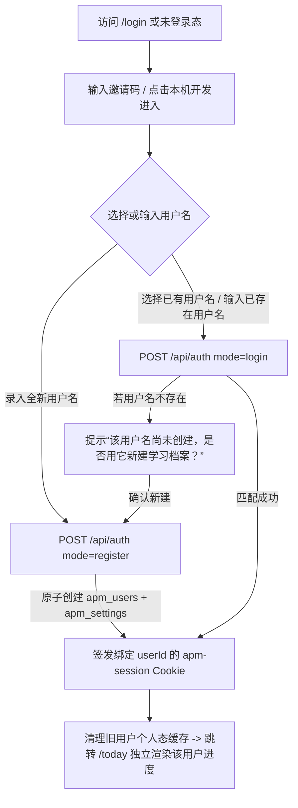

# SPEC-004 · 邀请码准入、用户名管理与多用户独立进度追踪

状态：方案设计与实施规格（Draft Spec），2026-10-17。前置依赖：`SPEC-001`（核心学习闭环）、`SPEC-003`（`v0.2` 零延迟客户端交互与缓存架构）。

## 1. 背景与核心目标

当前系统（`SPEC-001`）采用“单邀请码 = 单固定用户（`apm_users.access_code_hash UNIQUE`）”的私有单人模式，无法支持多位学习者通过同一邀请码进入并各自建立独立学习档案。

本规格将身份与进度体系升级为**“共享邀请码准入 + 独立用户名档案管理 + 全链路学习进度与页面渲染隔离”**：
1. **邀请码准入与新用户录入用户名**：持有有效邀请码（Access / Invite Code）的用户进入系统后，可选择已有用户名继续学习，或录入新的用户名创建专属学习空间。
2. **用户名全生命周期管理**：支持用户名规范化校验、重名检测、已注册用户名列表查看与快速切换、当前用户名修改（Rename）以及学习者档案状态管理。
3. **跨用户学习进度严格独立保存与追踪**：每位用户的学习偏好（`apm_settings`）、卡片 FSRS 记忆状态（`apm_review_states`）、复习历史与撤销日志（`apm_review_events`）、课程已读记录（`apm_study_activity`）按 `user_id` 完全隔离存储。
4. **按用户独立页面渲染与客户端缓存隔离**：不同用户名登录后，今日到期/新卡预算、知识地图已读进度、卡片库掌握状态、成长热力图及学习队列均按该用户真实数据独立渲染；客户端 `sessionStorage` 快照与 `revealCache` 严格绑定 `userId`，切换用户时零串染。

---

## 2. 验收标准（Acceptance Criteria）

| ID | 模块 | 验收要求与判据 |
| --- | --- | --- |
| **AC-U1** | **邀请码校验与用户名准入** | 1. 邀请码作为空间准入凭证（校验 SHA-256 哈希匹配系统有效邀请码，或本机开发快速通道）。<br>2. 老用户输入「邀请码 + 已有用户名」（或在验证邀请码后从已有用户名列表中选择）可直接进入对应学习空间。<br>3. 新用户通过邀请码录入新用户名时，需经过明确的“创建新学习者档案”操作（防止老用户拼写错误时误建空账号），原子创建 `apm_users` 与默认 `apm_settings` 并登录。 |
| **AC-U2** | **用户名规范与唯一性管理** | 1. 用户名展示值（`display_name`）保留用户输入的大小写，长度 2～24 个字符，允许中文、英文字母、数字、空格（首尾自动 trim）、下划线 `_` 与连字符 `-`，禁止控制字符。<br>2. 归一化标识 `username_normalized = lower(trim(display_name))` 在 `apm_users` 表中全局唯一（`UNIQUE`）。<br>3. 支持在「设置 / 用户管理」中修改自己的用户名（重名返回 `409 USERNAME_TAKEN`），修改后 `user_id` 与历史学习进度完全保持不变；支持查看空间内已管理的用户名列表及切换当前用户。 |
| **AC-U3** | **多用户学习进度独立持久化** | 1. 用户 A 与用户 B 各自评分卡片、撤销评分、标记课程已读、修改每日预算/保留率/章节熟悉度时，数据库仅更新当前会话 `user_id` 对应的 `apm_review_states`、`apm_review_events`、`apm_study_activity`、`apm_settings`。<br>2. 用户 A 的任何操作对用户 B 的到期队列、新卡额度、已读课程数、跨日保留率与热力图产生 **0 影响**。 |
| **AC-U4** | **多用户独立渲染与缓存防串染** | 1. 页面顶部导航头像、侧边栏底部个人卡片、设置页身份信息实时渲染当前登录用户的 `display_name`。<br>2. 客户端 `sessionStorage` Bootstrap 快照按 `userId` 校验/隔离；学习页 `revealCache` 键包含 `userId`（`${userId}:${cardId}:${stateVersion}:${settingsVersion}`）。<br>3. 在同一浏览器从用户 A 切换或登出再登录用户 B 时，立即渲染用户 B 的独立数据，绝不闪现用户 A 的进度快照，同时公共课程正文缓存（`lessonCache`）与卡片静态详情缓存（`cardDetailCache`）可安全跨用户复用以保持 `0ms` 秒开体验。 |
| **AC-U5** | **存量数据平滑兼容迁移** | 1. 新增增量迁移 `supabase/migrations/202610170001_multi_user_profiles.sql`，不破坏现有 `apm_` 表中的数据。<br>2. 既有 Owner 账号（如 `Klein`）自动回填 `username_normalized`，其已有设置、已读记录和复习历史 100% 保留。<br>3. 健康检查 `/api/health` 同步校验新迁移版本 `202610170001`。 |

---

## 3. 交互流程与界面设计（UX & Wireframes）

### 3.1 登录与新老用户分流流程（防误建空号设计）



### 3.2 登录页与用户名选择/录入界面（`/login`）

```text
+-----------------------------------------------------------------------+
|  recall.                              Welcome back                    |
|                                       进入你的学习空间                 |
|  把理解，                              输入邀请码，使用你的用户名继续  |
|  变成你的第二直觉。                     或创建新的独立学习档案。       |
|                                                                       |
|  [ 已有用户名继续 ]  [ + 新用户录入 ]   <-- 模式切换标签               |
|                                                                       |
|  学习邀请码                                                           |
|  [ **********************          ]                                  |
|                                                                       |
|  用户名                                                               |
|  [ 例如：Klein / 你的名字          ]                                  |
|  (若已验证邀请码，可点击下方已登记用户名快速填入： [Klein] [Alice] )   |
|                                                                       |
|  [         进入我的学习空间  ->        ]                               |
+-----------------------------------------------------------------------+
```

### 3.3 空间内用户名管理与切换（`/settings` 及侧栏个人区）

- **侧栏底部个人区（`WorkspaceSidebar`）**：
  - 显示当前用户名首字母徽章、`display_name` 与“切换用户 / 管理”入口。
- **学习偏好与用户管理页（`/settings` 新增「学习者身份与用户名管理」区块）**：
  - **当前用户名修改**：输入框支持修改当前用户的 `display_name`（实时保存并更新顶栏/侧栏展示）。
  - **已登记学习者名录（Directory & Quick Switch）**：展示当前空间下所有激活的用户名列表（包含用户名、创建时间、最近活跃时间），支持一键**切换至该用户**（无需重复输入邀请码，直接基于当前已认证会话切换 `apm-session` Cookie 并刷新 `Bootstrap`）或在列表底部直接**“+ 新增学习者用户名”**。

---

## 4. 数据库架构设计（Database Schema & Migration）

新建迁移文件 `supabase/migrations/202610170001_multi_user_profiles.sql`：

### 4.1 `apm_users` 表结构演进

1. **解除 `access_code_hash` 的单用户唯一限制**：
   - 原表定义 `access_code_hash text not null unique` 限制了一个邀请码只能对应一行 `apm_users`。
   - 迁移移除 `apm_users_access_code_hash_key` 唯一约束，使同一个邀请码哈希可被多位注册用户共享记录（作为该用户准入时的邀请码凭证指纹）。
2. **新增归一化唯一用户名与活跃时间戳**：
   - `username_normalized text`：存储 `lower(btrim(display_name))`。
   - 为存量记录回填 `username_normalized = lower(btrim(display_name))`（若存在空字符串则回填 `id::text`）。
   - 设为 `NOT NULL` 并建立唯一索引 `create unique index apm_users_username_idx on public.apm_users(username_normalized)`。
   - 新增字符合法性与长度约束：`check (char_length(btrim(display_name)) between 2 and 24)`。
   - 新增 `last_active_at timestamptz not null default now()`，用于用户名管理列表排序与活跃度展示。

### 4.2 原子化用户注册与初始化 RPC：`public.apm_register_user`

为防止并发注册同名用户或创建了 `apm_users` 却缺失 `apm_settings` 导致后续查询报错，提供 `service_role` 专用的事务函数：

```sql
create or replace function public.apm_register_user(
  p_display_name text,
  p_access_code_hash text
) returns public.apm_users language plpgsql security invoker set search_path='' as $$
declare
  v_clean_name text := btrim(regexp_replace(coalesce(p_display_name, ''), '\s+', ' ', 'g'));
  v_norm text := lower(v_clean_name);
  v_user public.apm_users;
begin
  if char_length(v_clean_name) < 2 or char_length(v_clean_name) > 24 then
    raise exception 'INVALID_USERNAME';
  end if;
  if exists(select 1 from public.apm_users where username_normalized = v_norm) then
    raise exception 'USERNAME_TAKEN';
  end if;
  insert into public.apm_users(id, display_name, username_normalized, access_code_hash, active, last_active_at)
  values (gen_random_uuid(), v_clean_name, v_norm, p_access_code_hash, true, now())
  returning * into v_user;

  insert into public.apm_settings(user_id)
  values (v_user.id)
  on conflict (user_id) do nothing;

  return v_user;
end $$;
```

---

## 5. 服务端 API 契约设计（API Contract）

### 5.1 邀请码验证与用户列表查询：`POST /api/auth/Directory`（或 `POST /api/auth/verify-code`）
- **输入**：`{ code?: string, local?: boolean }`
- **逻辑**：校验 `sha256(code)` 是否匹配环境变量 `APM_OWNER_ACCESS_CODE` 的哈希或库内已有合法邀请码哈希（或本机开发 `local=true`）。
- **输出**：返回 `{ valid: true, users: Array<{ id: string, display_name: string, last_active_at: string }> }`，供登录页展示可选的已有用户名列表。

### 5.2 登录与新用户创建：`POST /api/auth`
- **输入**：
  ```ts
  {
    code?: string;
    local?: boolean;
    username?: string;
    mode?: 'login' | 'register' | 'auto';
  }
  ```
- **行为**：
  1. 先校验邀请码 `code`（或 `local` 开发模式）是否有效；无效返回 `401 访问码无效`。
  2. 若未传 `username` 且 `local === true`，默认登录 Owner（向后兼容本机一键进入）。
  3. 对传入的 `username` 计算 `norm = username.trim().replace(/\s+/g, ' ').toLowerCase()`：
     - **`mode === 'login'`**：按 `username_normalized = norm` 查询激活用户。若存在，更新 `last_active_at` 并签发该 `user.id` 的 `apm-session` Cookie；若不存在，返回 `404 USER_NOT_FOUND`（前端据此提示用户是否以该名称创建新学习档案）。
     - **`mode === 'register'`**：调用 `apm_register_user` 原子创建新用户及默认 `apm_settings`。若重名返回 `409 USERNAME_TAKEN`；成功后签发该新 `user.id` 的 `apm-session` Cookie。

### 5.3 用户名管理与切换接口（需已登录会话）
1. **`GET /api/users`**：
   - 返回当前空间内所有激活用户的简要列表 `{ users: Array<{ id: string, display_name: string, created_at: string, last_active_at: string }> }`。
2. **`PATCH /api/users/me`（修改当前用户名）**：
   - 输入：`{ display_name: string }`
   - 校验长度（2～24）与唯一性（排除自身 `id`），更新 `display_name` 与 `username_normalized`，返回更新后的 `user`。
3. **`POST /api/users/switch`（快速切换学习者或新建学习者）**：
   - 输入：`{ userId?: string, newUsername?: string }`
   - 若传 `userId`：校验目标用户在 `apm_users` 中激活，重新签发绑定目标 `userId` 的 `apm-session` Cookie 并返回目标用户信息。
   - 若传 `newUsername`：复用当前已认证用户的 `access_code_hash` 调用 `apm_register_user` 创建新学习者，直接签发新用户的 `apm-session` Cookie 并返回。

---

## 6. 客户端缓存与多用户渲染隔离契约（Client Cache & Rendering Isolation）

在 `src/lib/client-cache.ts` 与 `src/components/studio.tsx` 中执行严格的**读写分离缓存策略**：

| 缓存对象 | 跨用户属性 | 多用户隔离策略 |
| --- | --- | --- |
| `lessonCache`（70 篇课程原文 Markdown） | **公共只读** | 跨用户安全保留，用户切换账号后看课依然 `0ms` 秒开 |
| `cardDetailCache`（408 张卡片标准答案/解析） | **公共只读** | 跨用户安全保留，不随用户切换清空 |
| `revealCache`（含个人 FSRS 候选状态与签名 Token） | **用户私有** | 缓存键升级为 `${userId}:${cardId}:${stateVersion}:${settingsVersion}`；切换/登出用户时调用 `clearUserSessionCaches()` 立即清空 |
| `sessionStorage` Bootstrap 快照 | **用户私有** | 存储结构校验 `user.id`；切换用户或重新登录时覆盖/清除旧快照，严禁在 React 状态中残留上一位用户的 `Bootstrap` 数据 |

---

## 7. 实施任务图（Task Graph & Tickets）

本规格拆分为 4 个有明确依赖关系的实施工单（可直接通过 `/implement-spec` 推进实现）：

- **T1（数据库迁移与种子脚本兼容）**：
  - 编写 `supabase/migrations/202610170001_multi_user_profiles.sql`（改造 `apm_users`、新增 `username_normalized` 唯一索引、新增 `apm_register_user` RPC、登记迁移版本 `202610170001`）。
  - 更新 `scripts/seed.ts` 与 `scripts/verify-database.ts`，支持多用户创建与进度隔离实测验证。
- **T2（服务端认证与用户名管理 API）**：
  - 升级 `src/lib/types.ts`、`src/lib/repository.ts` 与 `src/app/api/[...path]/route.ts`。
  - 实现邀请码校验、按用户名登录/注册（`POST /api/auth`）、用户名列表（`GET /api/users`）、修改用户名（`PATCH /api/users/me`）、切换/新建用户（`POST /api/users/switch`），以及 `/api/health` 迁移检查更新。
- **T3（客户端用户缓存隔离与登录/管理 UI）**：
  - 升级 `src/lib/client-cache.ts`：新增 `clearUserSessionCaches()`（清理 `revealCache` 与个人 `Bootstrap` 快照，保留公共 `lessonCache` / `cardDetailCache`），将 `revealKey` 绑定 `userId`。
  - 升级 `src/components/studio.tsx` 与 `src/components/workspace-navigation.tsx`：
    - 重构 `Login` 组件：支持「已有用户名登录 / 新用户录入用户名」、已登记用户名快捷选择标签、未找到用户名时的防呆确认建号提示。
    - 升级 `Preferences`（设置页）与侧栏个人区：新增「学习者身份管理」模块（修改当前用户名、查看已注册用户名列表、一键切换用户或新增学习者）。
- **T4（多用户隔离单元测试与端到端验证）**：
  - 新增 `tests/multi-user.test.ts` 测试用户名归一化、合法性校验、多用户状态与缓存隔离契约。
  - 若远端数据库可达，应用迁移并运行 `npm run db:verify` 与 `npm run deploy:check`，更新验证报告与 `docs/HANDOVER.md`。

依赖拓扑：`T1` → `T2` → `T3` → `T4`。
